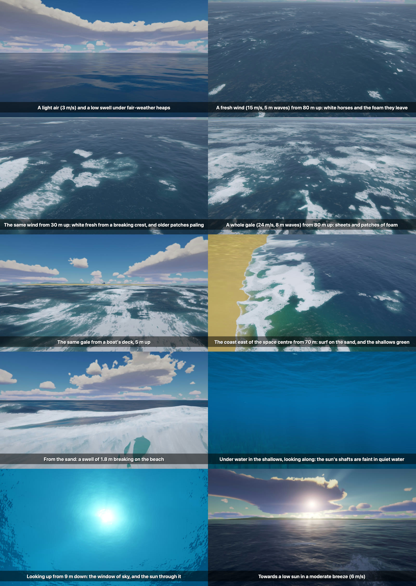
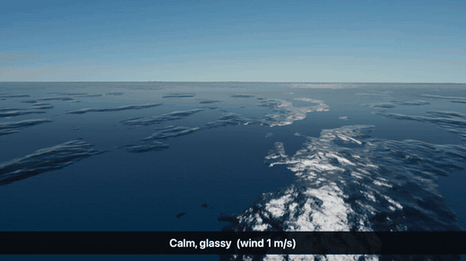
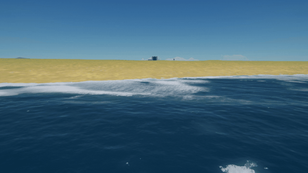
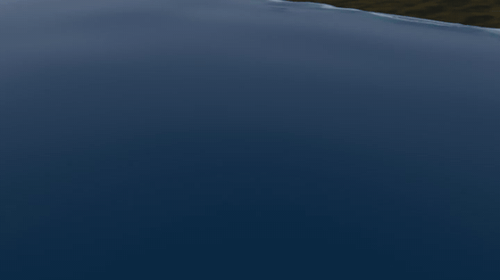
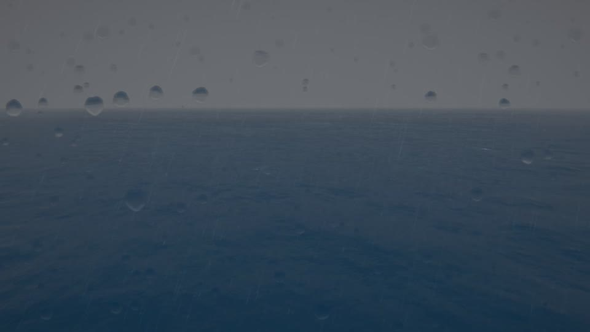

# Natural Ocean

A sea of its own for every world that has one: waves raised by the weather's wind, swell, white water where they
break, surf on the beach, seaweed in the shallows, rain on the water, the splash of a crash, the wake of a hull, and a
camera that can go half under.

**A first sea, not a finished one.** It reads as a sea at a glance; it does not yet stand beside a photograph of one.

For Kerbal Space Program 1.12.x. **Needs [Keystone](https://github.com/IshiakiZ/ksp-keystone) 0.9 or later**, a separate download
([on SpaceDock](https://spacedock.info/mod/4665/Keystone)): this mod does not load without it. With
[Natural Weather](https://github.com/IshiakiZ/ksp-natural-weather), which is not needed, the sea goes by the weather's wind and shows its
clouds' shadows; without it, by a light breeze.

## What it does

* **Waves from the wind,** higher and longer the harder it blows, with swell from elsewhere; slicks in light winds.
* **White water** where crests break, torn at its edge while fresh, and foam that lies, fades and gathers in bands.
* **The shore:** surf that breaks and runs up the sand, green water over the shallows, seaweed, and the sun's light
  in bright lines on a shallow bottom.
* **What floats rides the waves;** the craft you fly leaves a wake and throws spray at speed.
* **A crash makes a splash as big as the blow:** a crown and a jet tearing into sheets and strands, mist, white water
  in rings.
* **Rain on the sea:** rings where drops strike, a matt grey sea under overcast.
* **From high up,** one broad sheen where the sun is mirrored, in soft patches; by night the Mun's path (with
  [Natural Light](https://github.com/IshiakiZ/ksp-natural-light)).
* **Each world's own sea:** Eve's purple, roughened by its thick air; seaweed on Kerbin only.
* **A camera half under:** the waterline across the glass where the sea cuts it, and the water dimmer and bluer with
  depth.

## Install

Copy the `NaturalOcean` folder from the download into your KSP's `GameData`, beside `Keystone`.

## Settings

In the Keystone window (the keystone button on the game's toolbar, or Alt-K; Option-K on a Mac): how rough, how
clear the water is, whether craft ride the waves, seaweed, and whether other seas are put out of sight.

## Good to know

* **Still wrong:** a blowing sea looks tame from a boat's deck (a breaking crest is white laid on a smooth wave), and a
  splash leaves no ring of waves. [The plan](https://github.com/IshiakiZ/ksp-natural-ocean/wiki/Plan) says what comes next.
* The game's and Scatterer's seas are put out of sight where this one is drawn (Scatterer's settings are not
  touched). Beside other mods that draw the sea (Parallax, EVE) it has not been tried.

## Works on

Mac: tried. Windows 11 (Direct3D 11 and OpenGL): this version tried (the shore and its surf, storms and curling crests, under water); the wake, spray off a hull and the light on the bottom not yet. Linux: never run.

**More:** [the long description](https://github.com/IshiakiZ/ksp-natural-ocean/wiki/The-long-description) (everything in full, and what
was tried on each system) and the rest of the [wiki](https://github.com/IshiakiZ/ksp-natural-ocean/wiki).

## Licence

[CC BY 4.0](LICENSE): use it, change it and pass it on as you like, as long as you credit Ishiaki and link back here.
